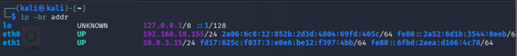
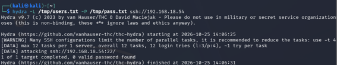
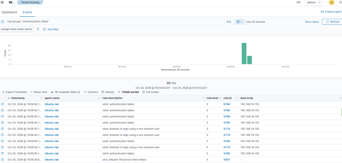
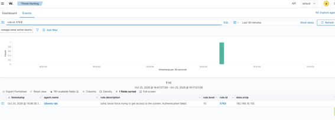

[🇪🇸 Español](README_es.md)

# SSH Brute-Force Detection: Hydra Attack and Detection with Wazuh

Lab exercise simulating an SSH brute-force attack with Hydra and analyzing how a SIEM correlates individual failed-authentication events into an attack alert, documented as an L1 SOC analyst triage case.

---

## MITRE ATT&CK Mapping

- **Tactics:** Credential Access.
- **Techniques:**
  - [T1110.001] Brute Force: Password Guessing (dictionary attack against the SSH service with Hydra)
  - [T1078] Valid Accounts (attempted validation of system user credentials)

---

## 1. Environment and Setup

The lab is made up of three machines on the same local network, on a bridged adapter:

| Machine | Role | IP |
|---|---|---|
| Kali Linux (VirtualBox) | Attacker — launches the brute-force attack with Hydra | `192.168.18.155` |
| Ubuntu-lab (VirtualBox, Wazuh agent 4.14.7) | Victim — SSH server targeted by the attack | `192.168.18.54` |
| Wazuh manager (wazuh-manager) | SIEM — receives and correlates the events | `192.168.18.113` |



*`ip -br addr` on Kali — confirms the source IP (192.168.18.155) that later appears in Wazuh's alerts.*

On Ubuntu-lab, confirm the SSH service is running:

```bash
sudo systemctl status ssh
```

On Kali, confirm Hydra is available:

```bash
which hydra || sudo apt install hydra -y
```

Create the test wordlists (simulating a basic user/password dictionary):

```bash
echo -e "jsmith\nadmin\nroot" > /tmp/users.txt
echo -e "123456\npassword\nadmin123\nwrongpass" > /tmp/pass.txt
```

---

## 2. Attack Execution

From Kali, against Ubuntu-lab's SSH:

```bash
hydra -L /tmp/users.txt -P /tmp/pass.txt ssh://192.168.18.54
```



*12 combinations tested (3 users × 4 passwords, every possible pair), none valid.*

**Result:**

```
[DATA] attacking ssh://192.168.18.54:22
1 of 1 target completed, 0 valid password found
```

---

## 3. Detection in Wazuh

### Individual events

Search in Threat Hunting:

```
agent.name: "Ubuntu-lab"
rule.groups: "authentication_failed"
```



*32 events within seconds, spread across:*
- `rule.id: 5760` — *sshd: authentication failed* (valid username, wrong password)
- `rule.id: 5710` — *Attempt to login using a non-existent user*
- `rule.id: 5557` — *unix_chkpwd: Password check failed*

### Correlation alert

```
rule.id: 5763
```



*1 event: "sshd: brute force trying to get access to the system. Authentication failed." — level 10, versus level 5 for the individual events.*

---

## 4. Incident Report

| Field | Detail |
|---|---|
| Date/time | 2026-10-25, 19:06:30 |
| Rule triggered | 5763 — SSH brute force |
| Severity | 10 (high) |
| Source IP | 192.168.18.155 |
| Affected system | Ubuntu-lab |
| Prior evidence | 32 failed-authentication events (rules 5760 / 5710) in the preceding seconds |
| Attack outcome | Unsuccessful — 0 valid credentials found |
| Recommended action | Temporarily block the source IP; consider Fail2Ban or an active response rule in Wazuh to automate the block |

---

## 5. Conclusion

Correlating individual events (level 5) into a brute-force alert (level 10) demonstrates the value of a SIEM over reviewing raw logs: an isolated event could be a simple user mistake, but the pattern grouped by IP and time is what distinguishes a real attack and justifies the escalation.

---

## 6. Next Steps

- Configure an active response rule in Wazuh to automatically block the IP after the 5763 alert.
- Repeat the exercise with a wordlist that includes the real password, to also document the successful-compromise case.
